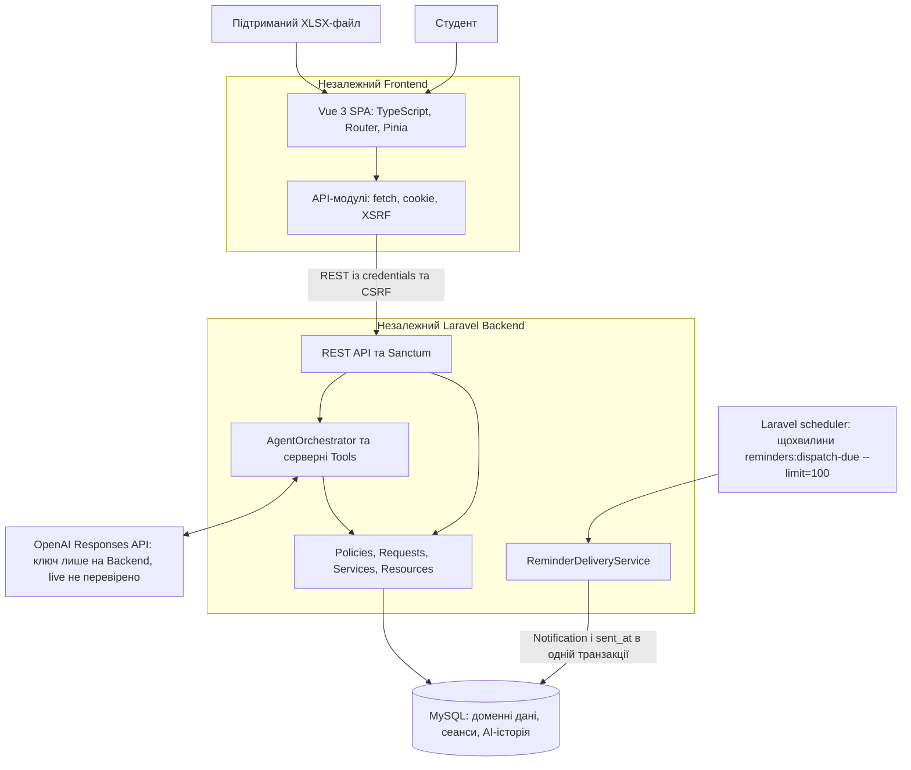
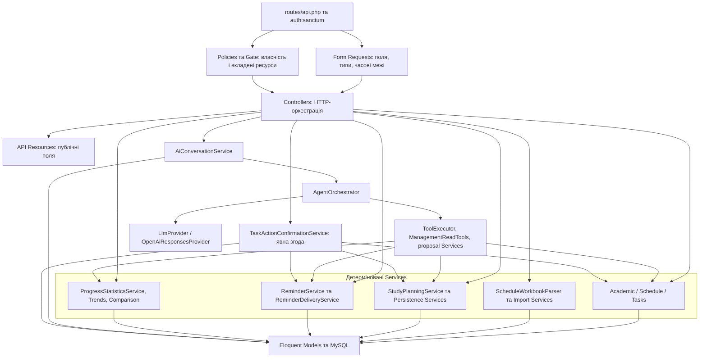
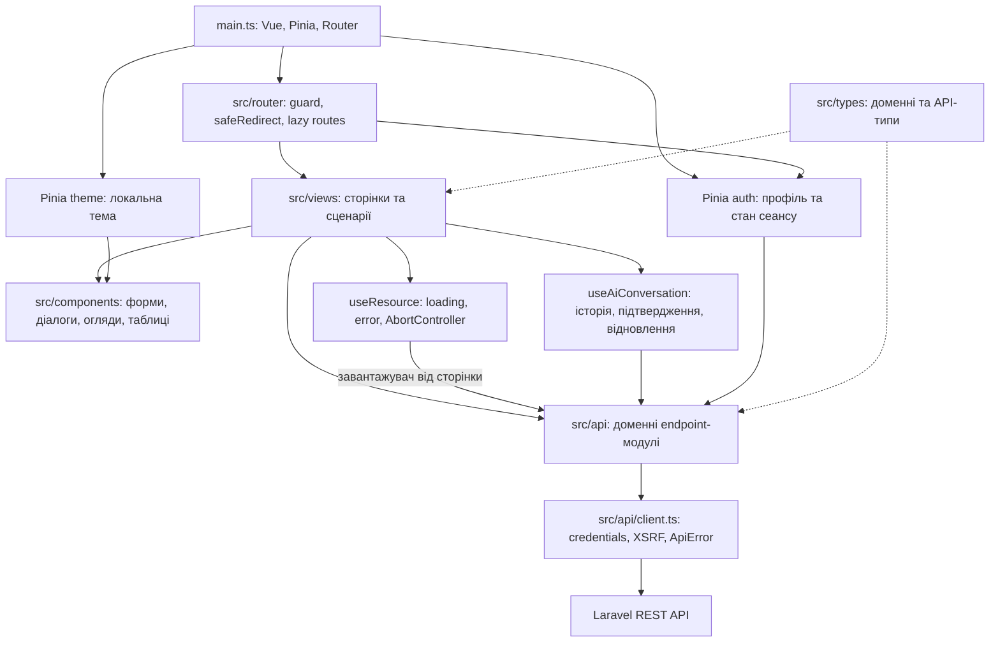
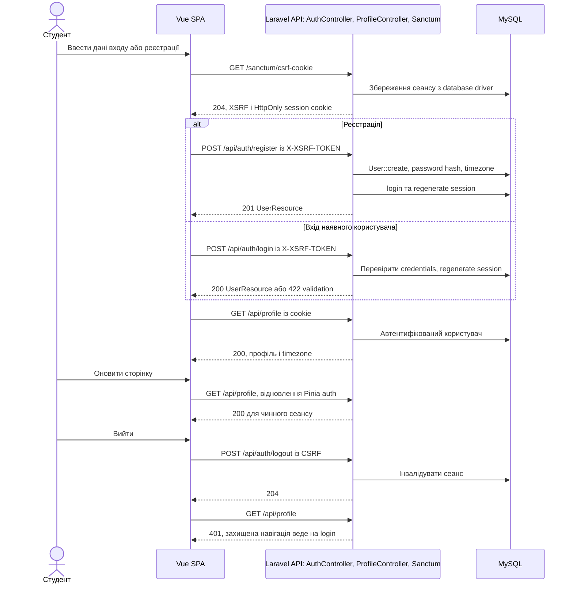
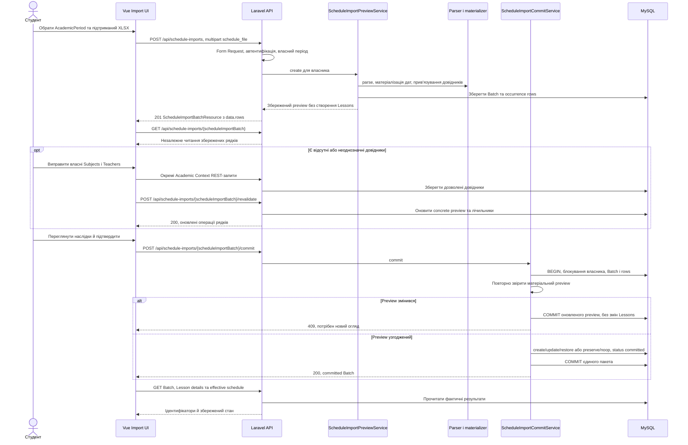
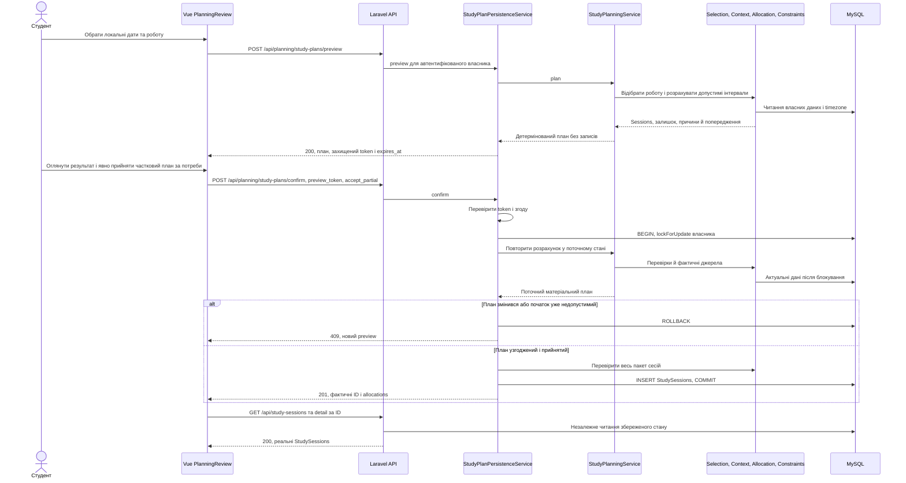
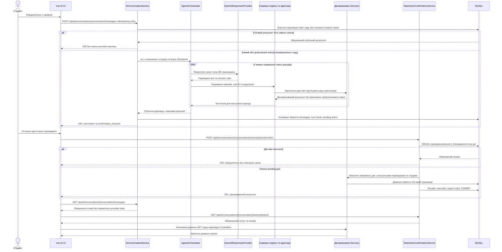
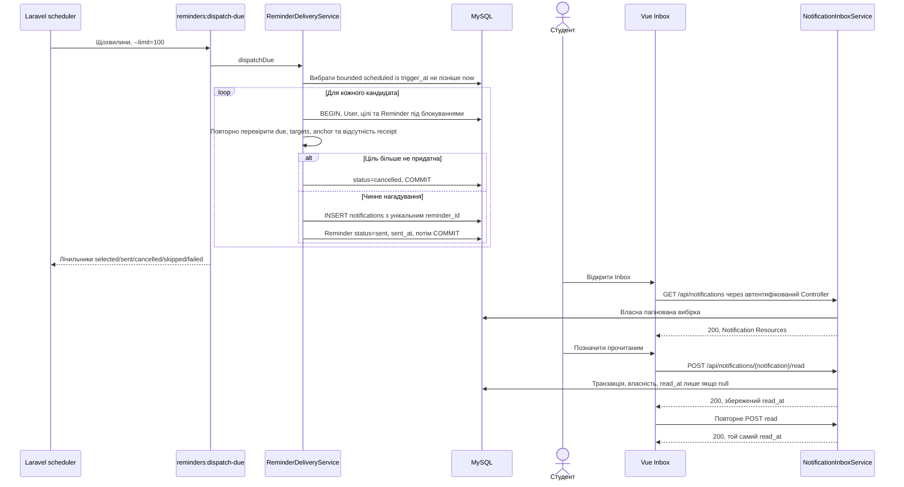

# Діаграми архітектури та взаємодії

[Зміст комплекту](../README.md) · [Архітектура](../architecture.md) · [Модель даних](../data-model.md)

Кожна діаграма має окремий `.mmd`-файл як редаговане першоджерело й тотожний Mermaid-блок нижче для GitHub-сумісного перегляду. Підписи українські, імена класів/маршрутів/колонок збережено з коду. Ці схеми описують реалізацію, а статус фактичного виконання визначає звіт приймання.

Послідовності скорочують частину middleware, Controller і Resource переходів заради читабельності; доменні HTTP-запити проходять відповідні Controllers/Requests/Policies. Помилкові та негативні гілки не є вичерпним state machine. Позначення ER: PK/FK/UK, звичайні cardinalities; logical morph і sessions.user_id без FK підписані окремо. Повний nullable/UNIQUE/CHECK-контракт — у міграціях, а не в скорочених атрибутах діаграми.

## Каталог

| Схема                         | Mermaid-джерело                                    | Зміст                                                                                         |
| ----------------------------- | -------------------------------------------------- | --------------------------------------------------------------------------------------------- |
| Система й зовнішні інтеграції | [system-architecture.mmd](system-architecture.mmd) | Межі SPA/Laravel/MySQL та окремі provider/scheduler гілки.                                    |
| Компоненти Backend            | [backend-components.mmd](backend-components.mmd)   | Логічні відповідальності; Request/Policy/Controller не є новими мережевими сервісами.         |
| Компоненти Frontend           | [frontend-components.mmd](frontend-components.mmd) | Views, компоненти, composables, два Pinia stores і HTTP-шар.                                  |
| Модель даних                  | [data-model.mmd](data-model.mmd)                   | Усі 28 таблиць, вибрані ключові поля; nullable і складені обмеження уточнено в data-model.md. |
| Автентифікація                | [authentication.mmd](authentication.mmd)           | Cookie/CSRF та database session driver, як у перевіреному Stage 8.                            |
| Імпорт XLSX                   | [xlsx-import.mmd](xlsx-import.mmd)                 | Збережений preview, довідники, revalidate, актуальний commit та 409.                          |
| Автоматичне планування        | [study-planning.mmd](study-planning.mmd)           | Preview без нових Sessions, token, повторна перевірка й транзакційний confirm.                |
| AI Tool та явне підтвердження | [ai-confirmation.mmd](ai-confirmation.mmd)         | Схема реалізованого протоколу; реальний paid-provider у Stage 8 не викликався.                |
| Доставка нагадувань           | [reminder-delivery.mmd](reminder-delivery.mmd)     | Схема існуючого коду; dispatcher/Notification delivery у Stage 8 live НЕ ЗАПУСКАЛИСЬ.         |

## Система й зовнішні інтеграції

Межі SPA/Laravel/MySQL та окремі provider/scheduler гілки.

[Редаговане джерело](system-architecture.mmd)

## Компоненти Backend

Логічні відповідальності; Request/Policy/Controller не є новими мережевими сервісами.

[Редаговане джерело](backend-components.mmd)

## Компоненти Frontend

Views, компоненти, composables, два Pinia stores і HTTP-шар.

[Редаговане джерело](frontend-components.mmd)

## Модель даних

Усі 28 таблиць, вибрані ключові поля; nullable і складені обмеження уточнено в data-model.md.

[Редаговане джерело](data-model.mmd)

```mermaid
erDiagram
    users {
        bigint id PK
        varchar name
        varchar email UK
        varchar password
        varchar timezone
    }
    planning_preferences {
        bigint user_id PK,FK
        smallint max_daily_study_minutes
        smallint max_weekly_study_minutes
        smallint preferred_break_minutes
        smallint min_session_minutes
        smallint max_session_minutes
    }
    study_availability_windows {
        bigint id PK
        bigint user_id FK
        tinyint day_of_week
        time starts_at
        time ends_at
    }
    education_institutions {
        bigint id PK
        bigint user_id FK
        varchar name
    }
    academic_periods {
        bigint id PK
        bigint user_id FK
        bigint education_institution_id FK
        varchar name
        date starts_on
        date ends_on
    }
    subjects {
        bigint id PK
        bigint user_id FK
        bigint education_institution_id FK
        varchar name
        varchar code
        char color
    }
    teachers {
        bigint id PK
        bigint user_id FK
        bigint education_institution_id FK
        varchar name
    }
    schedule_import_batches {
        bigint id PK
        bigint user_id FK
        bigint academic_period_id FK
        varchar status
        varchar original_filename
        char file_hash
        int total_rows
        int valid_rows
        int invalid_rows
        int duplicate_rows
        datetime committed_at
    }
    schedule_import_rows {
        bigint id PK
        bigint schedule_import_batch_id FK
        int row_number
        varchar status
        json raw_data
        json normalized_data
        json validation_errors
        char fingerprint
    }
    lessons {
        bigint id PK
        bigint user_id FK
        bigint academic_period_id FK
        bigint subject_id FK
        bigint teacher_id FK
        bigint schedule_import_batch_id FK
        bigint replaces_lesson_id FK,UK
        varchar type
        datetime starts_at
        datetime ends_at
        varchar status
        char import_fingerprint
        timestamp deleted_at
    }
    tasks {
        bigint id PK
        bigint user_id FK
        bigint subject_id FK
        varchar title
        varchar status
        tinyint priority
        smallint estimated_minutes
        datetime deadline_at
        datetime completed_at
        timestamp deleted_at
    }
    subtasks {
        bigint id PK
        bigint task_id FK
        varchar title
        smallint position
        varchar status
        smallint estimated_minutes
        datetime deadline_at
        datetime completed_at
        timestamp deleted_at
    }
    study_sessions {
        bigint id PK
        bigint user_id FK
        bigint task_id FK
        bigint subtask_id FK
        bigint rescheduled_from_session_id FK,UK
        datetime starts_at
        datetime ends_at
        varchar status
        datetime completed_at
        smallint actual_minutes
    }
    reminders {
        bigint id PK
        bigint user_id FK
        bigint task_id FK
        bigint subtask_id FK
        bigint study_session_id FK
        varchar message
        datetime trigger_at
        varchar anchor
        smallint offset_minutes
        varchar status
        datetime sent_at
    }
    notifications {
        char id PK
        varchar type
        varchar notifiable_type
        bigint notifiable_id
        bigint reminder_id FK,UK
        json data
        timestamp read_at
    }
    ai_conversations {
        bigint id PK
        bigint user_id FK
        timestamp created_at
        timestamp updated_at
    }
    ai_messages {
        bigint id PK
        bigint conversation_id FK
        varchar role
        longtext content
        json tool_calls
        varchar tool_call_id
        timestamp created_at
    }
    ai_conversation_turns {
        bigint id PK
        bigint conversation_id FK
        char request_id
        char input_hash
        char lease_token
        datetime lease_expires_at
        json result
    }
    ai_pending_actions {
        char id PK
        bigint conversation_id FK
        bigint turn_id FK,UK
        varchar call_id
        varchar type
        json arguments
        json preview
        char target_hash
        varchar status
        datetime expires_at
        json receipt
        datetime resolved_at
        longtext protected_payload
    }
    sessions {
        varchar id PK
        bigint user_id
        longtext payload
        int last_activity
    }
    password_reset_tokens {
        varchar email PK
        varchar token
        timestamp created_at
    }
    personal_access_tokens {
        bigint id PK
        varchar tokenable_type
        bigint tokenable_id
        varchar token UK
        timestamp expires_at
    }
    cache {
        varchar key PK
        mediumtext value
        bigint expiration
    }
    cache_locks {
        varchar key PK
        varchar owner
        bigint expiration
    }
    jobs {
        bigint id PK
        varchar queue
        longtext payload
        smallint attempts
    }
    job_batches {
        varchar id PK
        varchar name
        int total_jobs
        int pending_jobs
        int failed_jobs
    }
    failed_jobs {
        bigint id PK
        varchar uuid UK
        varchar connection
        longtext exception
    }
    migrations {
        int id PK
        varchar migration
        int batch
    }
    users ||--o| planning_preferences : "user_id є PK та FK"
    users ||..o{ study_availability_windows : "user_id"
    users ||..o{ education_institutions : "user_id"
    users ||..o{ academic_periods : "user_id"
    users ||..o{ subjects : "user_id"
    users ||..o{ teachers : "user_id"
    users ||..o{ schedule_import_batches : "user_id"
    users ||..o{ lessons : "user_id"
    users ||..o{ tasks : "user_id"
    users ||..o{ study_sessions : "user_id"
    users ||..o{ reminders : "user_id"
    users ||..o{ ai_conversations : "user_id"
    education_institutions |o..o{ academic_periods : "education_institution_id nullable"
    education_institutions |o..o{ subjects : "education_institution_id nullable"
    education_institutions |o..o{ teachers : "education_institution_id nullable"
    academic_periods ||..o{ schedule_import_batches : "academic_period_id"
    academic_periods |o..o{ lessons : "academic_period_id nullable"
    subjects ||..o{ lessons : "subject_id"
    subjects |o..o{ tasks : "subject_id nullable"
    teachers |o..o{ lessons : "teacher_id nullable"
    schedule_import_batches ||..o{ schedule_import_rows : "schedule_import_batch_id"
    schedule_import_batches |o..o{ lessons : "schedule_import_batch_id nullable"
    lessons |o..o| lessons : "replaces_lesson_id nullable UNIQUE"
    tasks ||..o{ subtasks : "task_id"
    tasks ||..o{ study_sessions : "task_id"
    subtasks |o..o{ study_sessions : "subtask_id nullable"
    study_sessions |o..o| study_sessions : "rescheduled_from_session_id nullable UNIQUE"
    tasks |o..o{ reminders : "task_id nullable"
    subtasks |o..o{ reminders : "subtask_id nullable"
    study_sessions |o..o{ reminders : "study_session_id nullable"
    reminders |o..o| notifications : "reminder_id nullable UNIQUE"
    users ||..o{ notifications : "notifiable: логічний morph без FK до users"
    users |o..o{ sessions : "логічний user_id без FK"
    ai_conversations ||..o{ ai_messages : "conversation_id"
    ai_conversations ||..o{ ai_conversation_turns : "conversation_id"
    ai_conversations ||..o{ ai_pending_actions : "conversation_id"
    ai_conversation_turns ||..o| ai_pending_actions : "turn_id UNIQUE"
```

## Автентифікація

Cookie/CSRF та database session driver, як у перевіреному Stage 8.

[Редаговане джерело](authentication.mmd)

## Імпорт XLSX

Збережений preview, довідники, revalidate, актуальний commit та 409.

[Редаговане джерело](xlsx-import.mmd)

## Автоматичне планування

Preview без нових Sessions, token, повторна перевірка й транзакційний confirm.

[Редаговане джерело](study-planning.mmd)

## AI Tool та явне підтвердження

Схема реалізованого протоколу; реальний paid-provider у Stage 8 не викликався.

[Редаговане джерело](ai-confirmation.mmd)

## Доставка нагадувань

Схема існуючого коду; dispatcher/Notification delivery у Stage 8 live НЕ ЗАПУСКАЛИСЬ.

[Редаговане джерело](reminder-delivery.mmd)

## Перевірка й використання

Синтаксис і фактичний SVG-рендер перевіряються локальним Mermaid 11.17.2 у Chromium, окремо від застосунку. Результати та спосіб відтворення наведені у [verification.md](../verification.md). Тимчасові parser/browser залежності встановлено поза репозиторієм; package.json і lockfile застосунку не змінені.

Для слайдів експортувати потрібний фрагмент у SVG/PNG з Mermaid-сумісного редактора або локального рендерера. Повна ER придатна для технічного додатка; на слайді показати читабельну предметну підмножину. Діаграми не створювалися у Figma, не потребують його доступу та не доводять Figma-паритет.
