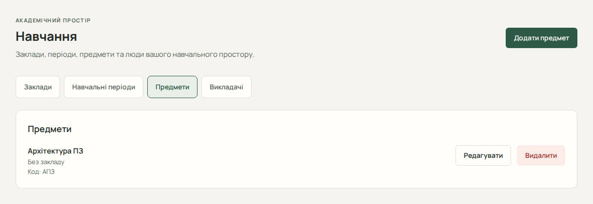

# Навчання: заклади, періоди, предмети та викладачі

Розділ «Навчання» містить ваші персональні довідники. Це не спільний каталог університету і не адміністративна панель. Підготуйте назви предметів та викладачів; для імпорту звірте їх із файлом розкладу.

## У якому порядку створювати записи

| Запис             | Для чого потрібен                                           |
| ----------------- | ----------------------------------------------------------- |
| Заклад            | Пов’язує записи з місцем навчання                           |
| Навчальний період | Задає початок і кінець семестру, використовується в імпорті |
| Предмет           | Позначає заняття та, за бажанням, завдання                  |
| Викладач          | Додає викладача до заняття                                  |

Періоди, предмети й викладачі можуть мати необов’язковий зв’язок із закладом. Належність до одного закладу не створює решту записів автоматично.

## Додати й відредагувати

1. Відкрийте «Навчання» й виберіть вкладку потрібного довідника.
2. Натисніть кнопку додавання у верхній частині сторінки.
3. Заповніть назву або ім’я. За потреби виберіть «Навчальний заклад» чи «Без закладу».
4. Для періоду задайте «Початок періоду» та «Кінець періоду». Для предмета можна вказати код і колір.
5. Збережіть форму. Після успіху запис з’явиться в оновленому списку.
6. Для зміни натисніть «Редагувати» біля відповідного запису й збережіть виправлення.

## Видалити й виправити помилки

Натисніть «Видалити», прочитайте пояснення залежностей у діалозі та підтвердьте лише потрібне видалення. Сервер може заборонити його через використання запису в інших даних; автоматичного видалення всіх залежних записів немає. При видаленні закладу пов’язані записи зберігаються без прив’язки; при видаленні предмета завдання залишаються без нього; для викладача заняття можуть залишитися без викладача. Дотримуйтеся пояснення конкретного діалогу. Перегляньте пов’язані заняття чи інші записи, а не повторюйте те саме видалення.

Для імпорту потрібні відповідні власні предмети й викладачі. Однакові імена викладачів дозволені, але можуть зробити зіставлення неоднозначним. Після виправлень довідників поверніться до пакета імпорту й натисніть «Повторно перевірити».

Далі: [заняття розкладу](guide/schedule.md) або [імпорт Excel](guide/excel-import.md).
