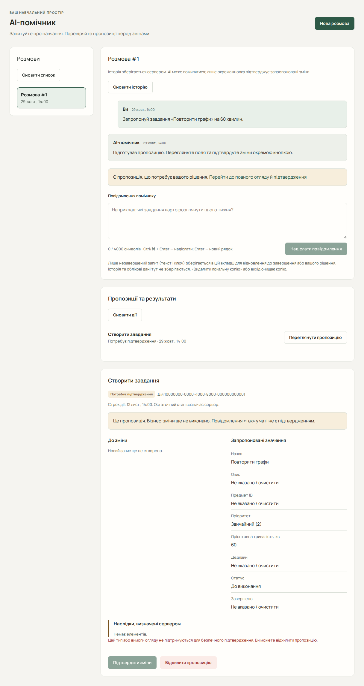

# AI-помічник і підтвердження дій

AI-помічник допомагає читати навчальні дані та готувати підтримані зміни. Потрібні вхід і налаштований сервером AI-провайдер. Попередні детерміновані перевірки інтерфейсу не встановили доступність зовнішнього OpenAI; якщо провайдер не налаштований або недоступний, запит може завершитися помилкою.

## Почати розмову

1. Відкрийте «AI-помічник» → «Нова розмова».
2. Виберіть розмову, уведіть запит і надішліть його.
3. Прочитайте відповідь і результати Tools — інструментів, якими помічник отримує дані чи готує пропозиції.
4. В історії перевірте, який інструмент спрацював і чи був його результат успішним. Текстова відповідь сама по собі не доводить збереження змін.

Приклади запитів: «Покажи мої відкриті завдання», «Знайди вільний час на найближчий тиждень», «Запропонуй завдання “Повторити графи” на 60 хвилин до п’ятниці», «Запропонуй нагадування за 30 хвилин до дедлайну цього завдання». Уточнюйте дати, назви та потрібну роботу; перед рішенням звіряйте фактичні поля огляду.

## Переглянути й дозволити зміну

1. Відкрийте запропоновану дію, що очікує підтвердження.
2. Перевірте ціль, значення, строк дії й наслідки. Для планування прочитайте сесії, попередження та нерозподілену роботу.
3. Якщо потрібні окремі дозволи на частковий результат чи скасування без заміни, позначте їх лише після перевірки.
4. Натисніть «Підтвердити зміни» для застосування або «Відхилити пропозицію» для відмови.
5. Після виконання прочитайте «Квитанція виконання», відкрийте відповідний запис чи сесії й перевірте результат.

Питання до помічника та дозвіл на постійну зміну — різні кроки. Підтверджуйте лише потрібний, зрозумілий результат.

## Що підтримується

Доступні пропозиції створити, змінити, завершити й повторно відкрити завдання та підзавдання; створити, змінити й скасувати нагадування; створити навчальний план, адаптивно перепланувати роботу й перенести сесію. Допустимість кожної дії перевіряє сервер.

**AI-створення, редагування, скасування та заміна занять Lesson ще не доступні для підтвердження в цьому інтерфейсі.** Для них користуйтеся [ручним керуванням розкладом](guide/schedule.md). Невідомий тип пропозиції можна прочитати й відхилити, але не підтвердити.

## Відновлення після помилок

- Прострочена або застаріла дія потребує нової пропозиції. Оновіть поточні дані та попросіть помічника підготувати її заново.
- Після невизначеної відповіді на рішення використайте «Перевірити стан дії» або «Перевірити поточний стан дії», коли така кнопка показана. Перевірте квитанцію перед новим запитом.
- Якщо виконання не вдалося, прочитайте повідомлення: невдала спроба не дорівнює виконаній дії. Непридатний огляд замініть новою пропозицією.
- Якщо повідомлення втратило відповідь, оновіть історію. «Повторити цей запит», коли доступне, відновлює той самий запит; не надсилайте його як новий навмання.
- Якщо дію виконано, а пов’язані дані не оновилися, натисніть «Оновити пов’язані дані». Це читання, а не повторне виконання.

