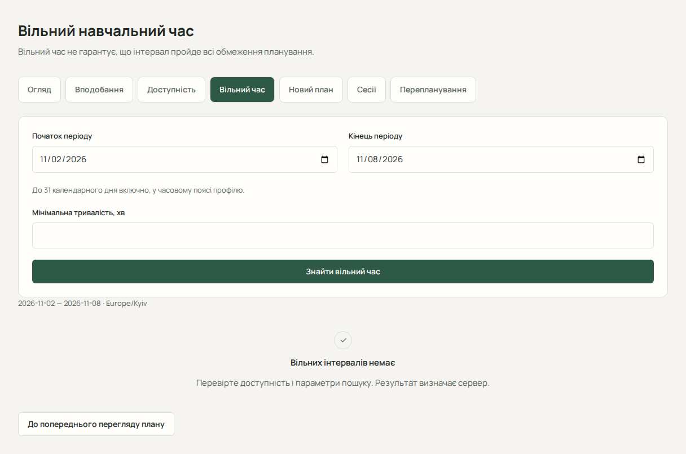

# Доступність і вільний час

Ці сторінки допомагають указати, коли ви можете працювати самостійно, і знайти незайняті інтервали. Відкрийте «Планування» та відповідний підрозділ. Перед налаштуванням перевірте часовий пояс і додайте актуальні заняття.

## Налаштувати вподобання

1. Відкрийте вкладку «Вподобання» (сторінка «Вподобання навчання»).
2. Задайте денний і тижневий ліміти навчання, бажану перерву, мінімальну та максимальну тривалість сесії.
3. Залиште поле порожнім, якщо обмеження не налаштоване. Порожнє значення не гарантує виділення часу.
4. Натисніть «Зберегти вподобання» й дочекайтеся повідомлення про успіх.

Максимальна сесія не може бути коротшою за мінімальну, а тижневий ліміт — меншим за денний. За помилки виправте значення відповідно до повідомлення.

## Додати щотижневе вікно

1. Відкрийте «Доступність» → «Додати інтервал».
2. Виберіть день тижня, початок і кінець, наприклад понеділок 17:00–19:00.
3. Натисніть «Зберегти інтервал». Він з’явиться в картці відповідного дня й повторюватиметься щотижня за місцевим часом профілю.
4. Для виправлення скористайтеся «Редагувати»; для вилучення — «Видалити» та підтвердженням.

Кінець має бути пізніше початку. Нічне вікно розбийте на два дні; кінець дня можна задати як `24:00:00`. Зміна доступності впливає на наступні розрахунки, але сама не запускає перепланування.

## Знайти вільні інтервали

1. Відкрийте «Вільний час».
2. Задайте початкову й кінцеву дати та, за потреби, мінімальну тривалість у хвилинах.
3. Натисніть «Знайти вільний час».
4. Перегляньте межі й тривалість повернутих сервером слотів.

Якщо слотів немає, перевірте щотижневі вікна, зайнятість і мінімальну тривалість; виберіть інший допустимий діапазон. Для помилки читання доступна повторна спроба.

> Знайдений вільний інтервал ще не гарантує проходження всіх обмежень плану. Остаточну здійсненність визначає сервер.

Далі: [створіть огляд плану](guide/planning.md).
