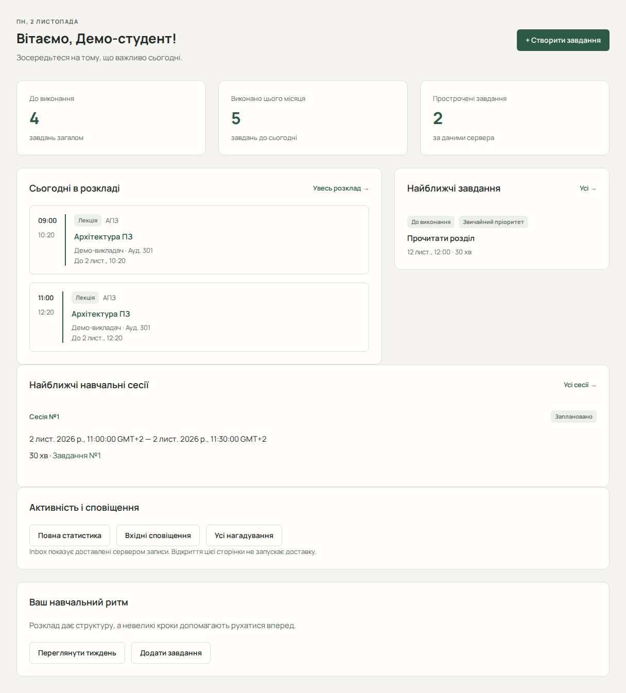

# Огляд

«Огляд» — початкова сторінка після входу. Вона допомагає вибрати наступну дію. Для змістовного огляду спочатку додайте заняття й завдання; порожні блоки нового облікового запису не є помилкою.

## Прочитайте головну сторінку

1. Відкрийте «Огляд» в основній навігації.
2. Перевірте дату: вона визначається часовим поясом профілю.
3. Перегляньте картки «До виконання», «Виконано цього місяця» та «Прострочені завдання».
4. У «Сьогодні в розкладі» виберіть потрібне заняття або «Увесь розклад».
5. У «Найближчі завдання» відкрийте роботу або натисніть «Усі».
6. У «Найближчі навчальні сесії» перегляньте заплановану самостійну роботу.

## Швидко почніть роботу

«+ Створити завдання» відкриває форму нового завдання. «Переглянути тиждень» веде до тижневого розкладу. Блок «Активність і сповіщення» дає переходи до повної статистики, вхідних сповіщень і нагадувань.

Після переходу відкривається відповідна сторінка; сама навігація не змінює ваших записів і не запускає доставку нагадувань.

## Що означають числа

«До виконання» та прострочені завдання — поточні загальні показники. Виконане цього місяця рахується від початку місцевого місяця до сьогодні. Список найближчих завдань показує лише перші п’ять відкритих записів у серверному порядку дедлайнів. Блок сесій показує до чотирьох ще актуальних запланованих сесій у семиденному діапазоні.

## Якщо блок порожній або недоступний

«Сьогодні немає занять» стосується лише поточного дня. Перевірте тиждень, перш ніж додавати заняття повторно. Помилка одного блоку не доводить відсутність даних: використайте його кнопку повторного читання. Для детального аналізу відкрийте [статистику](guide/statistics.md).

