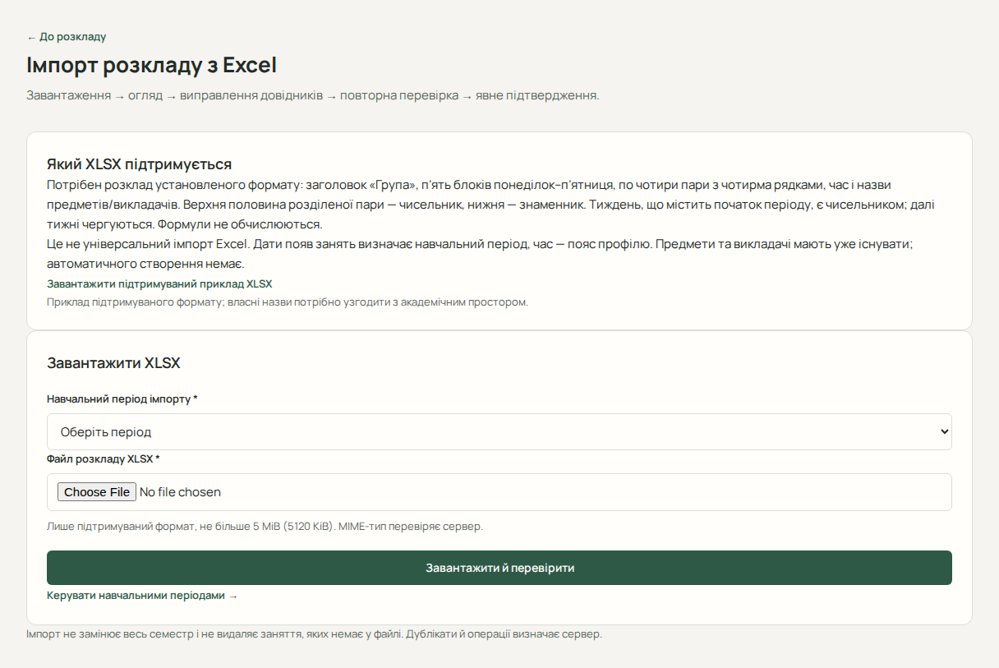
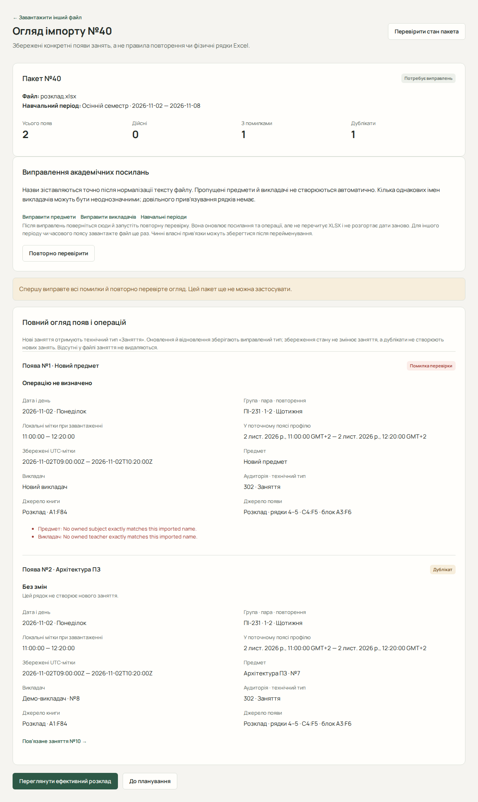

# Імпорт розкладу з Excel

Застосунок імпортує щотижневі правила семестру або датовані заняття. Для обох процесів підготуйте навчальний період та перевірте часовий пояс профілю. Семестровий імпорт автоматично створює відсутні коректні предмети й викладачів після підтвердження; для старого імпорту ці записи мають уже існувати.

## Імпорт семестрових правил

1. У «Розклад» натисніть «Імпорт семестру з Excel». Виберіть навчальний період із прив’язаним закладом та XLSX. Сервер визначить понеділок тижня, що містить початок періоду, та встановить перший тиждень як чисельник.
2. В огляді перевірте всі щотижневі пари, наявні й запропоновані нові предмети та викладачів, лічильники, правила для видалення і збережені заміни та робочі суботи. Огляд також показує збережені пари, які втратять посилання на видалене правило.
3. Виправте неоднозначні або некоректні назви у файлі чи академічному просторі (змінений файл завантажте заново) та натисніть «Повторно перевірити». Якщо рядок заблоковано захищеним слотом, перевірте його в семестрі. За потреби явно зніміть захист, потім повторно перевірте огляд.
4. Відкрийте підтвердження, прочитайте наслідки й позначте, що переглянули операції. Після підтвердження відкриється семестровий розклад зі збереженою квитанцією, яка містить назви та фактичні ID створених і повторно використаних записів, понеділок відліку й парність.
5. Якщо огляд застарів, перевірте нові операції та підтвердьте знову. Якщо відповідь втрачено, натисніть «Перевірити стан пакета». Це покаже збережений огляд або квитанцію.

Семестровий імпорт оновлює щотижневі правила й може видалити раніше імпортовані правила, які відсутні у новому файлі. Захищені ручні правила та збережені списки на окремі дати залишаються чинними. Повторне завантаження того самого файлу створює окремий огляд.

Для семестрового імпорту двох викладачів у клітинці розділяйте крапкою з комою або переносом рядка, наприклад «Когут В.С.; Петренко І.П.». Кома або коса риска підтримуються, якщо кожна частина однозначно позначає людину; ініціали не розділяйте. Порожня клітинка означає «Без викладача». Усі викладачі відображаються в одній парі з однією аудиторією та одним інтервалом часу.

## Старий імпорт датованих занять

Відкрийте «Старий розклад → Старий імпорт Excel», щоб розгорнути пари з файлу в конкретні дати. Нижче описано цей окремий процес.

## Підготуйте підтриманий файл

Скористайтеся [прикладом XLSX](../examples/schedule-example.xlsx ':ignore :download'). Файл має бути `.xlsx` розміром до 5120 КБ. Це спеціальний шаблон, а не довільна таблиця з колонками дат.

Підтриманий формат містить заголовок «Група», п’ять блоків понеділок–п’ятниця, по чотири пари з чотирма рядками, час, назви предметів і викладачів. Верхня половина розділеної пари — чисельник, нижня — знаменник. Тиждень із початком періоду є чисельником, далі тижні чергуються. Формули не обчислюються.

Не змінюйте структуру шаблону довільно. Замініть демонстраційні назви власними та узгодьте їх із розділом «Навчання». Предмети й викладачі автоматично не створюються.

## Завантажте й прочитайте огляд

1. У «Старий розклад» відкрийте «Старий імпорт Excel».
2. Виберіть «Навчальний період імпорту» й файл у «Файл розкладу XLSX».
3. Натисніть кнопку завантаження та дочекайтеся сторінки «Огляд імпорту №…».
4. Перевірте період, часовий пояс, лічильники та всі конкретні появи занять. Один рядок огляду не обов’язково дорівнює одному фізичному рядку файлу.
5. Прочитайте помилки й заплановану операцію кожного рядка.

| Операція            | Що відбудеться після підтвердження   |
| ------------------- | ------------------------------------ |
| Створення           | Додається нове заняття               |
| Оновлення           | Змінюється відповідне наявне заняття |
| Відновлення         | Відновлюється відповідний запис      |
| Збереження стану    | Чинний стан лишається                |
| Без змін / дублікат | Нове заняття не створюється          |

## Виправте й підтвердьте

1. Для невідомого предмета чи викладача перейдіть через «Виправити предмети» або «Виправити викладачів». Виправте назви чи додайте потрібний власний запис.
2. Поверніться до цього пакета та натисніть «Повторно перевірити». Перевірка оновлює прив’язки й операції, але не перечитує XLSX і не розгортає дати заново.
3. Лише для перевіреного пакета відкрийте «Переглянути підтвердження імпорту».
4. Перегляньте наслідки, установіть прапорець згоди та натисніть «Підтвердити імпорт».
5. Після успіху перевірте збережений результат і «Переглянути ефективний розклад».

Завантаження ще не змінює заняття. Імпорт не видаляє занять, яких немає у файлі, та не замінює весь семестр.

## Застарілий огляд і відновлення

Якщо сервер повідомив конфлікт (409), огляд міг оновитися без застосування змін. Прочитайте нові рядки й лічильники та підтвердьте заново; попередня згода скидається. Після втрати відповіді скористайтеся «Перевірити стан пакета»: читання показує збережений стан без повторного застосування.

Пакет зі станом помилки обробки потрібно замінити новим завантаженням після виправлення файлу. Для іншого періоду чи часового поясу також потрібне нове завантаження. Якщо втрачено саме відповідь завантаження й номер пакета невідомий, автоматичного пошуку пакета немає; повторне завантаження створить окремий огляд. Збережіть відому адресу пакета, щоб повернутися до нього.

