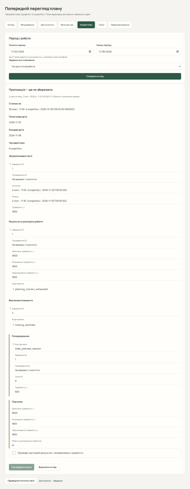

# Навчальний план і перепланування

План розподіляє самостійну роботу між навчальними сесіями. Перед початком перевірте оцінки тривалості, дедлайни, заняття, доступність і вподобання. Обчислення та остаточну можливість розміщення визначає сервер.

## Отримати огляд

1. Відкрийте «Планування» → «Новий план».
2. Задайте діапазон дат і виберіть усю доступну роботу або конкретне завдання. Для вибраного завдання можна обрати підзавдання.
3. Якщо потрібного завдання немає на поточній сторінці вибору, скористайтеся кнопками попередніх/наступних завдань.
4. Натисніть «Створити огляд».
5. У «Пропозиція — ще не збережено» перевірте запропоновані сесії, причини виключення роботи, попередження й нерозподілену тривалість.

За наявності активних підзавдань планувальник працює з ними, щоб не рахувати обсяг батьківського завдання двічі. Завершену або непридатну роботу може бути виключено з поясненням.

## Підтвердити результат

1. Якщо план частковий, вирішіть, чи прийнятний залишок, і лише тоді встановіть «Приймаю частковий результат і неперенесену тривалість».
2. Натисніть «Підтвердити зміни». До цього моменту огляд не створює сесій.
3. Перевірте «Збережений результат» і «Перевірити поточні сесії».

«Відхилити огляд» прибирає пропозицію без її застосування. Якщо змін для підтвердження немає, перевірте доступність і оцінки роботи. Частковий результат означає, що деяку роботу не вдалося розмістити; збільшення діапазону чи зміна обмежень може допомогти, але не гарантує повного плану.

## Відновити невиконану роботу

1. У «Планування» відкрийте «Відновлення роботи».
2. Виберіть період для **нових** сесій — до 31 календарної дати включно. Залиште «Уся доступна робота» або виберіть завдання й, за потреби, його підзавдання. Кнопки попередніх/наступних завдань допоможуть знайти потрібне. Відновлювати можна й придатні невиконані завдання, для яких немає пропущених сесій.
3. Натисніть «Знайти час для невиконаної роботи». Огляд нічого не зберігає.
4. У діагностиці перевірте кількість придатних одиниць роботи, пропущені та минулі заплановані сесії. Їхня історія охоплює **всі дати вибраної роботи**, незалежно від періоду для нових сесій.
5. Перегляньте запропоновані нові сесії, нерозподілену тривалість, виключену роботу, попередження та строк дії огляду. Якщо погоджуєтеся на частковий результат, явно встановіть «Приймаю частковий план і нерозподілений залишок роботи».
6. Натисніть «Підтвердити зміни». Перевірте «Збережений результат», відкрийте збережені сесії або «Перевірити поточні сесії».

З картки чи сторінки завдання «Не виконано» можна перейти кнопкою «Відновити роботу»: завдання буде вибрано після перевірки сервером, зокрема поза першою сторінкою списку. Це не запускає огляд або підтвердження автоматично. Якщо завдання недоступне чи посилання некоректне, виправте вибір або явно виберіть усю доступну роботу.

Стан завдання «Не виконано» не означає наявність пропущених сесій: лічильники історії описують саме сесії. Сервер враховує виконані зусилля та майбутні резервування; прострочений дедлайн, відсутня оцінка або повністю зарезервований залишок можуть виключити роботу з нової пропозиції. Позначення завдання невиконаним не обходить цих обмежень і саме по собі нічого не переплановує.

**Пропущені сесії** — історичні записи явного пропуску; відновлення їх не змінює. **Минулі заплановані сесії** досі мають стан «Заплановано». Відкрийте посилання на таку сесію та самі виберіть дозволену дію. Попередження про необхідність цього рішення є порадою і не забороняє підтвердити чинну пропозицію нових сесій.

Відновлення розподіляє залишок роботи, а не переносить кожен пропуск один до одного. Воно не завершує, не позначає пропущеними й не скасовує старі сесії або їхні нагадування. Це дія, яку запускає та підтверджує студент, а не автономне фонове перенесення.

Якщо нових сесій немає, підтвердження недоступне: прочитайте причини та перевірте залишок роботи й доступність. «Відхилити огляд» прибирає навіть порожню пропозицію без змін. Зміна дат, завдання чи підзавдання скидає попередній огляд і згоду на частковий план.

За конфлікту, простроченого огляду або втраченої відповіді старе підтвердження стає недоступним і автоматично не повторюється. Спершу перевірте поточні сесії: запит міг уже зберегти новий план. Після зіставлення даних отримайте новий огляд.

## Адаптивне перепланування

Відкрийте «Перепланування», виберіть період і роботу та створіть огляд. Прочитайте, які початкові сесії зберігаються, замінюються чи не можуть бути перенесені. Якщо дозволяєте скасування джерел без заміни, надайте окрему згоду на цей наслідок.

Підтвердження може скасувати заплановані нагадування початкових сесій; вони не копіюються до наступників. Перевірте нові сесії й створіть потрібні нагадування окремо. Перепланування запускаєте ви; це не автоматичне фонове перенесення після кожної зміни даних.

## Застарілий огляд або невідома відповідь

Огляд має строк дії. Якщо дані змінилися, строк минув або підтвердження втратило відповідь, перевірте поточні сесії перед новою дією. Не повторюйте старе підтвердження: спочатку зіставте збережені записи, потім створіть новий огляд. Нова помилка конфлікту не доводить, що попередній запит нічого не зберіг.

Далі: [керування сесіями](guide/study-sessions.md).
