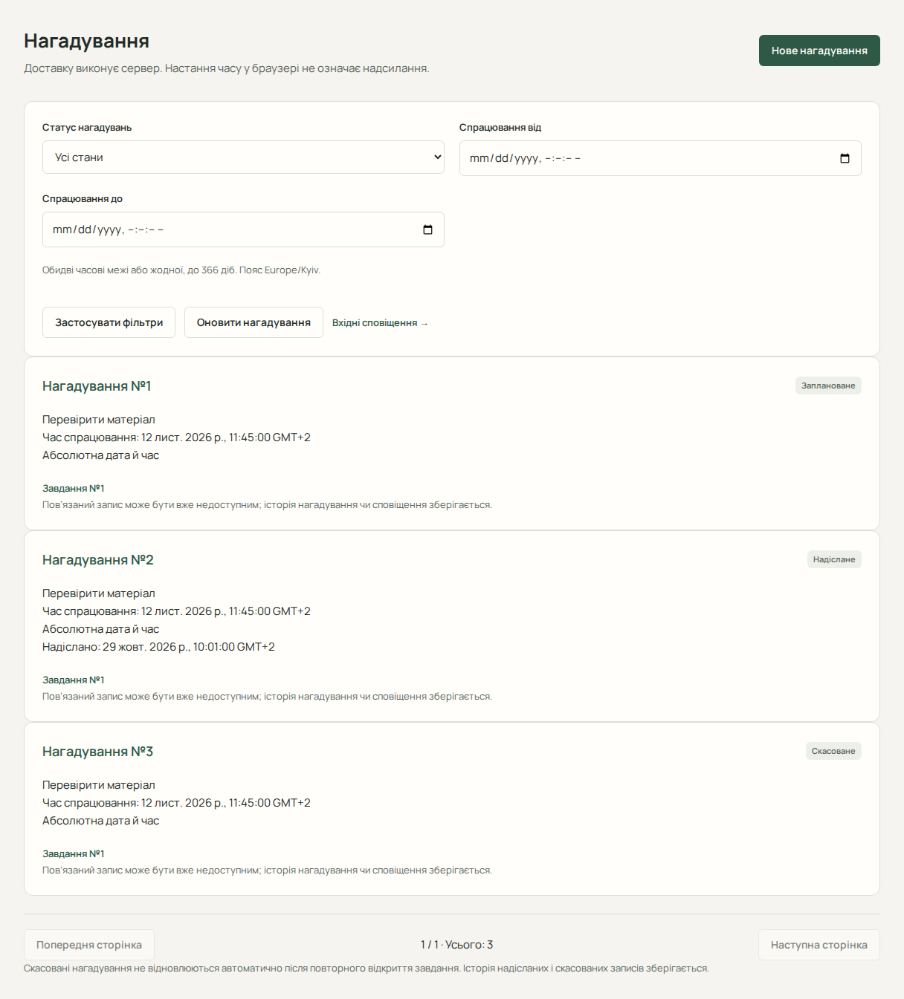

# Нагадування

Нагадування (Reminder) — запланована умова сповіщення. Його створення ще не означає появу запису у «Вхідних». Для роботи підготуйте майбутній час або завдання з дедлайном / заплановану сесію.

## Створити абсолютне нагадування

1. Відкрийте «Нагадування» й форму нового нагадування.
2. Виберіть «Абсолютна дата й час».
3. Уведіть повідомлення та майбутній «Час нагадування» в поясі профілю.
4. Натисніть «Створити нагадування» й перевірте деталі та стан «Заплановане».

Для загального нагадування без пов’язаного запису потрібен змістовний текст до 500 символів. Для нагадування про конкретну роботу починайте зі сторінки завдання, підзавдання чи сесії через її посилання на нагадування.

## Створити відносне нагадування

1. Відкрийте створення нагадування з потрібної роботи або сесії.
2. Виберіть «Відносно роботи або сесії».
3. Перевірте прив’язку: дедлайн завдання, власний дедлайн підзавдання або початок сесії.
4. Укажіть ціле «Зміщення, хвилини», наприклад `-30` для пів години до події. Нуль означає час події, додатне значення — після.
5. Збережіть і перевірте розрахований сервером час.

Допустиме зміщення: від -32768 до 32767 хвилин. Підзавдання без власного дедлайну не використовує дедлайн батька як заміну.

## Змінити чи скасувати

У списку можна фільтрувати за станом і парою часових меж та переходити між сторінками. Відкрийте деталі. Редагування доступне лише для запланованого нагадування: змінюється повідомлення та абсолютний час або відносне зміщення. Ціль, режим і прив’язка не змінюються; для іншої цілі скасуйте запис і створіть новий.

Скасування потребує явного підтвердження. Надіслані та скасовані записи лишаються історією; видалення, повторне відкриття або ручне надсилання не передбачені.

## Синхронізація й помилки

Зміни дедлайнів і станів пов’язаної роботи обробляє сервер. Після завершення чи видалення роботи перевіряйте актуальний стан нагадувань. Скасоване нагадування не оживає після повторного відкриття роботи. Після перенесення сесії перевірте нагадування для наступника: старі не копіюються.

Якщо результат створення невідомий, спочатку перевірте список. Якщо заплановане нагадування не з’явилося у «Вхідних», перевірте [доставку сповіщень](guide/notifications.md).

