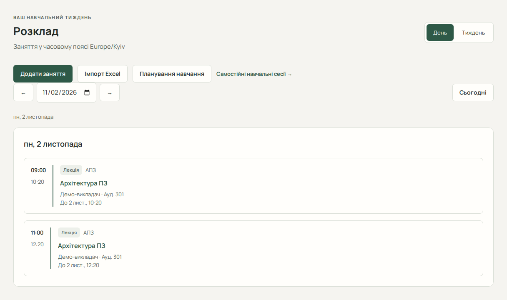

# Розклад і заняття

Заняття (Lesson) — обов’язкова подія розкладу, наприклад лекція. Навчальна сесія (StudySession) — окремо запланована самостійна робота над завданням. Для ручного заняття підготуйте предмет, правильний часовий пояс і часовий інтервал; викладача й період обирайте за потреби.

## Семестровий розклад

1. Відкрийте «Розклад» і виберіть навчальний період та групу. У режимі «Тиждень» показано понеділок–неділю. Стрілки змінюють дату або тиждень, а «Сьогодні» повертає до поточної дати.
2. Щоб почати з порожнього розкладу, натисніть «Створити семестр». Виберіть період із прив’язаним закладом, введіть групу, понеділок відліку та парність цього тижня.
3. У «Керування семестром» додайте щотижневі пари. Виберіть будній день, номер пари, повторення, місцевий час та предмет. Позначення пари, викладач і аудиторія необов’язкові.
4. «Змінити пару на весь семестр» відкриває правило повторення. «Замінити пару тільки на цю дату» відкриває редактор одного дня. Тут можна змінити або скасувати окрему пару, додати пару чи скасувати всі пари. «Відновити щотижневий розклад» видаляє збережену заміну й повертає поточний базовий день.
5. Для робочої суботи виберіть дату та будній день того самого тижня. Збережена копія редагується окремо. Подальші зміни дня-джерела не змінять збережену копію. Інші суботи зберігають свій розклад.
6. Видалене щотижневе правило захищено від повторного створення. У «Захищені видалені слоти» можна явно зняти захист, а потім додати правило вручну або повторно перевірити Excel.

Якщо семестр змінився в іншій вкладці, завантажте поточний стан і звірте його зі своєю чернеткою перед новим збереженням. Вільний час, навчальні плани та AI-помічник враховують датовані заняття зі старого розкладу.

## Старий розклад датованих занять

Перейдіть за посиланням «Старий розклад». Тут можна переглядати й змінювати датовані заняття, створені вручну, старим імпортом або AI-помічником.

## Переглянути день або тиждень

1. Відкрийте «Старий розклад».
2. Виберіть день чи тиждень та потрібну дату. Стрілки переміщують поточний період, «Сьогодні» повертає до поточної дати.
3. Відкрийте картку заняття, щоб побачити предмет, викладача, аудиторію, тип, час і стан.

Ефективний розклад показує актуальні заняття з урахуванням замін. Скасований оригінал не слід сприймати як чинну подію.

## Створити та змінити заняття

1. Натисніть «Додати заняття».
2. Виберіть «Предмет заняття», введіть початок і завершення. Додайте доступні необов’язкові відомості.
3. Натисніть «Створити заняття». Успіх відкриє сторінку «Заняття №…».
4. Для виправлення відкрийте «Редагувати заняття», змініть потрібні поля й натисніть «Зберегти заняття».

## Скасувати, замінити чи видалити

- «Скасувати заняття» доступне для активного заняття; підтвердження виключає його з ефективного розкладу.
- «Замінити заняття» відкриває форму нової заміни. Перевірте новий час і натисніть «Створити заміну». Можливість заміни залежить від стану та наявних зв’язків.
- «Видалити заняття» потребує підтвердження. Оригінал із чинною заміною видалити не можна.
- Скасування заміни не відновлює оригінал. Видалення заміни може відновити його лише після серверної перевірки конфліктів; прочитайте пояснення в діалозі.

## Конфлікти та обмеження

За помилки часу перевірте завершення після початку, часовий пояс і сусідні події. Сервер визначає допустимість інтервалу; не обходьте відмову повторними натисканнями. Після невизначеної відповіді перевірте актуальні деталі й розклад. Історія м’яко видалених записів може зберігатися.

Далі: [імпорт Excel](guide/excel-import.md).
