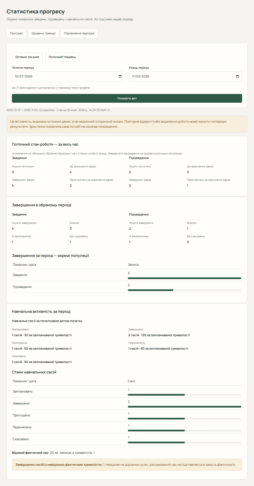

# Статистика, тренди та порівняння

Статистика допомагає переглянути збережену активність. Це фактичні дані, а не оцінка вашої успішності. Спочатку створіть роботу й відзначайте виконання; новий обліковий запис може показувати нульові значення.

## Переглянути прогрес

1. Відкрийте «Статистика».
2. Виберіть початок і кінець періоду, не більше 31 календарної дати включно, та натисніть «Показати звіт».
3. Перевірте поточні стани завдань і підзавдань окремо від завершень за період.
4. Перегляньте сесії за станами та їх заплановану тривалість.
5. Перегляньте «Загальний відсоток виконаних завдань» у поточному стані та «Навчальне навантаження за предметами» за обраний період.

Поточна кількість відкритої роботи не є її історичною кількістю на кінець вибраного періоду. Завдання та підзавдання — окремі групи, які не слід додавати як незалежний обсяг роботи.

### Загальний відсоток виконаних завдань

Це частка виконаних завдань серед усіх поточних завдань незалежно від вибраних дат. Сервер обчислює її без підзавдань і видалених завдань. Значення показано з одним десятковим знаком: наприклад, `33,3 %`. Якщо виконаних завдань немає, але завдання є, показано `0,0 %`. Якщо завдань узагалі немає — «Ще немає завдань».

Зміна періоду оновлює завершення та навантаження за датами, але не обмежує загальний відсоток цим періодом. Він може змінитися після зміни поточних завдань.

### Навчальне навантаження за предметами

Розділ показує заплановану тривалість навчання, кількість сесій, відомі фактичні хвилини завершених сесій та кількість завершених сесій без фактичної тривалості. Предмети відображаються в порядку сервера: за спаданням запланованого навантаження, далі за ідентифікатором предмета. Сесії без предмета показано як «Без предмета». За відсутності даних показано пояснення порожнього періоду.

Ураховуються лише заплановані й завершені сесії, початок яких припадає на обраний період у часовому поясі звіту. Пропущені, скасовані та перенесені сесії не входять у це навантаження. Групування використовує поточний предмет завдання; сесії підзавдань успадковують предмет батьківського завдання.

Запланована тривалість — час, відведений на сесії, а відомий фактичний час — записані хвилини завершених сесій. Це різні показники. Якщо завершена сесія не має записаної фактичної тривалості, фактичний час неповний: інтерфейс показує кількість таких сесій і попередження. Невідоме не означає нуль і не замінюється запланованим часом. «Немає записаних хвилин» означає відсутність записів фактичної тривалості, а не відсутність навчальних зусиль.

Обидва нові показники доступні на сторінці прогресу; щоденні тренди й порівняння зберігають власні показники.

## Прочитати тренди

Перейдіть до «Тренди», виберіть період і перегляньте графіки та доступні числові таблиці. Вони показують завершення завдань і підзавдань, активність сесій та відомі фактичні хвилини за днями. Дні без активності теж відображаються.

Сесія належить до місцевої дати її початку, навіть якщо закінчилася після опівночі. Невідома фактична тривалість не перетворюється на нуль і не підмінюється запланованою: такі завершені сесії враховуються окремо.

## Порівняти два періоди

1. Відкрийте «Порівняння».
2. Виберіть базовий, а потім поточний період: вони мають бути однакової календарної довжини, до 31 дати кожен, і не перетинатися.
3. Застосуйте форму та прочитайте обидва набори значень і різницю зі знаком.

«Зросло» означає більше зафіксованої активності, а не автоматично краще навчання. Якщо є сесії без фактичних хвилин, порівняння відомого часу неповне.

## Помилки та межі показників

За відмови перевірте порядок дат, тривалість і неперетин періодів. За помилки завантаження повторіть читання. Після виправлення чи повторного відкриття роботи старі звіти можуть змінитися, бо показують поточні збережені дані.

Немає експорту PDF/Excel, прогнозу оцінок або AI-оцінки продуктивності.

