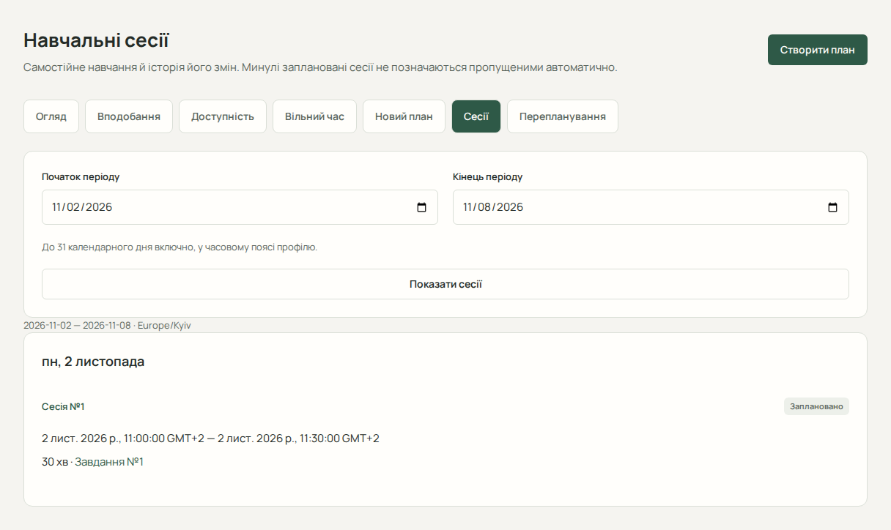

# Навчальні сесії

Навчальна сесія (StudySession) резервує час для самостійної роботи над завданням або підзавданням. Вона відрізняється від заняття розкладу (Lesson). Спершу створіть і підтвердьте навчальний план.

## Переглянути й відкрити сесію

1. У «Планування» відкрийте «Сесії».
2. Виберіть період і натисніть «Показати сесії».
3. Відкрийте сесію з потрібної дати. Перевірте її роботу, час, стан і зв’язки з попередником чи наступником.

## Завершення та пропуск

На сторінці запланованої сесії доступне «Керування сесією». Дозволеність операції остаточно перевіряє сервер, навіть якщо кнопку видно.

| Дія                    | Коли дозволена для запланованої сесії       |
| ---------------------- | ------------------------------------------- |
| «Завершити сесію»      | Початок уже настав                          |
| «Позначити пропущеною» | Завершення вже настало                      |
| «Скасувати сесію»      | До початку                                  |
| «Перенести сесію»      | До початку, за допустимого нового інтервалу |

Для завершення за бажанням укажіть позитивні «Фактична тривалість, хв». Порожнє поле означає невідому тривалість, а не нуль. Після успіху перевірте оновлений стан. Завершення сесії не є командою завершити всі пов’язані завдання.

## Скасувати або перенести

Скасування потребує підтвердження й скасовує також заплановані залежні нагадування, зберігаючи історію.

Для перенесення натисніть «Перенести сесію», введіть «Новий початок» і «Нове завершення», натисніть «Переглянути наслідки». Перевірте тривалість і підтвердьте перенесення. Цей локальний перегляд не є серверною гарантією: здійсненність перевіряється під час застосування.

Перенесення позначає початкову сесію перенесеною й створює наступника. Коротша заміна залишає частину роботи нерозміщеною. Старі заплановані нагадування скасовуються без копіювання.

## Помилки та межі

Історичні завершені, пропущені, скасовані чи перенесені сесії не можна довільно відредагувати або знову відкрити. За конфлікту перегляньте зайнятість і виберіть інший час. Після невизначеної відповіді перевірте поточну сесію та історію; не повторюйте зміну навмання. Неоднозначний час переходу на літній/зимовий час потрібно замінити однозначним.

Далі: [нагадування для сесії](guide/reminders.md).
