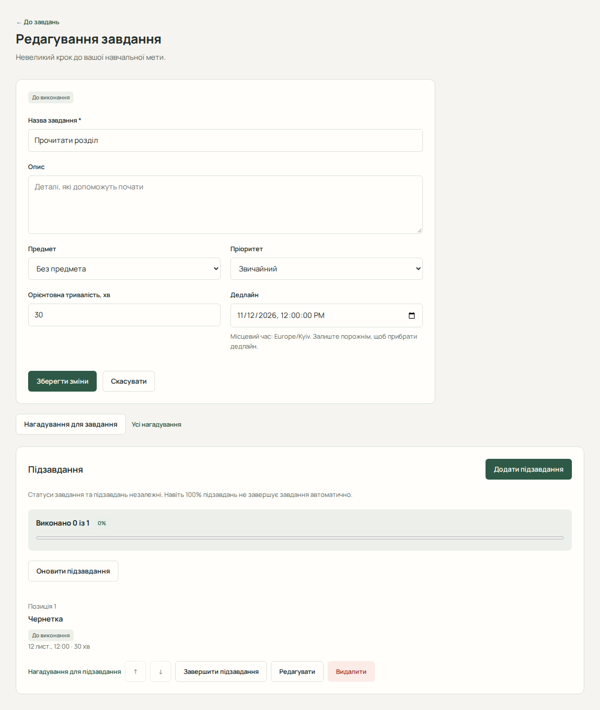

# Завдання та підзавдання

Завдання (Task) описує результат роботи, наприклад «Здати лабораторну». Підзавдання (Subtask) розбиває його на кроки: «Реалізувати алгоритм», «Написати висновки». Для початку достатньо назви; предмет необов’язковий. Для планування додайте реалістичні оцінки тривалості й дедлайни.

## Створити або змінити завдання

1. Відкрийте «Завдання» → «+ Створити завдання».
2. Заповніть «Назва завдання», за потреби «Опис» і «Предмет».
3. Виберіть пріоритет: низький, звичайний або високий.
4. Укажіть орієнтовну тривалість у хвилинах і дедлайн у часовому поясі профілю.
5. Збережіть форму й перевірте запис у списку.
6. Для зміни відкрийте завдання, відредагуйте поля та збережіть. Очищення необов’язкового поля прибирає його значення.

Якщо предмети не завантажилися, можна зберегти завдання без предмета, а прив’язку додати пізніше.

## Знайти роботу та змінити стан

У списку задайте статус, пріоритет, предмет або верхню межу дедлайну й натисніть «Застосувати». «Назад» і «Далі» перемикають сторінки. Сортування визначає сервер.

Завдання має три стани:

- **Очікує виконання** (`pending`) — активна незавершена робота.
- **Не виконано** (`missed`) — активна незавершена робота, яку ви явно позначили невиконаною у визначений час.
- **Виконано** (`completed`) — завершена робота.

Фільтри точні: «Очікує виконання» не включає «Не виконано». Щоб переглянути обидві групи, виберіть «Усі статуси». Прострочення означає минулий дедлайн для будь-якого незавершеного завдання, зокрема «Не виконано»; це не окремий стан. Завершене завдання не показується простроченим.

Для завдання «Очікує виконання» доступні «Завершити» та «Позначити невиконаним». Для «Не виконано» — «Завершити», «Повернути до виконання» та «Відновити роботу». Завершене завдання можна повернути до виконання окремою дією; без цього позначити його невиконаним не можна. Видалення потребує підтвердження.

## Відновити невиконане завдання

Натисніть «Відновити роботу» на картці або сторінці завдання зі станом «Не виконано». Відкриється наявна сторінка відновлення з вибраним завданням, навіть якщо воно було на іншій сторінці списку. Перевірте назву, виберіть дати та явно запросіть огляд. Сервер перевіряє доступ до завдання й можливість планування. Часткову пропозицію потрібно окремо прийняти, а нові сесії зберігаються лише після «Підтвердити зміни».

Позначення «Не виконано» саме по собі не переносить роботу, не створює сесій і не змінює стани підзавдань. Невиконане **завдання** та пропущена **навчальна сесія** — різні записи: завдання може не мати жодної пропущеної сесії. Прострочений дедлайн, відсутня оцінка тривалості або вже зарезервований обсяг можуть завадити новому розміщенню; причини показує огляд. Докладніше: [відновлення роботи](guide/planning.md#відновити-невиконану-роботу).

## Керувати підзавданнями

1. Відкрийте наявне завдання та блок підзавдань.
2. Додайте назву, за потреби опис, власний дедлайн і тривалість; збережіть.
3. Редагуйте, завершуйте, відкривайте повторно або видаляйте потрібний крок.
4. Змінюйте порядок кнопками переміщення вгору й униз, зокрема з клавіатури.

Прогрес надходить із сервера й рахується за кількістю підзавдань, а не їх хвилинами. Без активних підзавдань відсоток може бути відсутній. Завершення батьківського завдання не завершує дітей або навчальні сесії автоматично.

Підзавдання зберігають лише два стани: очікування та виконання. Стан «Не виконано» стосується саме завдання.

## Якщо результат збереження невідомий

Після мережевої чи серверної помилки форма може заблокувати повторне збереження й показати «Перевірити актуальні завдання». Перейдіть до списку, знайдіть запис і перевірте його поля. Не створюйте другу копію, поки не з’ясували результат. Помилку перевірки полів виправляйте у формі; після втрати сеансу спочатку відновіть вхід.

Якщо результат зміни стану невідомий, запит автоматично не повторюється. Натисніть «Перевірити поточний стан завдання №…»: це лише читання з сервера. За конфлікту сторінка сама запитує актуальний запис і не відкриває завершене завдання автоматично. Якщо перевірка не вдалася, повторіть читання доступною кнопкою; не вважайте зміну успішною до звірки даних. «Оновити список завдань» також повторно завантажує список без зміни записів.

Далі: [доступність](guide/availability.md) та [планування](guide/planning.md).
